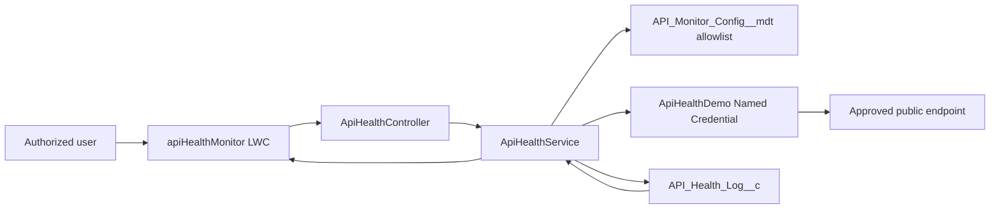

# Salesforce API Health Monitor

A Salesforce Lightning observability dashboard for checking an approved allowlist of HTTP GET endpoints on demand. It combines secure Named Credential callouts, persisted health-check results, and a responsive Lightning Web Component dashboard.

## Highlights

- Professional `apiHealthMonitor` Lightning Web Component with loading feedback, actionable errors, responsive SLDS-compatible styling, and Lightning theme support.
- Four concise KPI cards: healthy APIs, failed APIs, unknown APIs, and average latency.
- Persisted endpoint table with status badges, HTTP codes, formatted check times, response latency, and per-endpoint **Check now** actions.
- Responsive latency-history SVG with readable axes, dynamic padded Y-axis scaling, and green/red markers for successful/failed HTTP observations.
- Missing latency and transport-only errors are deliberately excluded from the numeric chart rather than misrepresented as `0 ms`.
- Metadata allowlist: the browser sends only a configuration key, never an arbitrary URL.
- Sanitized `API_Health_Log__c` records contain safe operational metadata only; response bodies, headers, and secrets are never stored or displayed.

## Demo scenarios

The project uses the public [httpbin.org](https://httpbin.org/) test service through the unauthenticated `ApiHealthDemo` Named Credential. No secret is stored in the source.

| Configuration | Relative path | Expected result | Purpose |
| --- | --- | --- | --- |
| `Public_Status_Demo` | `/status/200` | Healthy HTTP 200 | Baseline availability check |
| `Public_Get_Demo` | `/get` | Healthy HTTP 200 | Additional successful endpoint |
| `Public_503_Failure_Demo` | `/status/503` | Failed HTTP 503 | Intentional failure-state demonstration |

The HTTP 503 scenario is intentional and is shown as a failed check with its real measured latency. These public endpoints are suitable only for a portfolio demonstration, not for production monitoring.

## Architecture



`ApiHealthController` enforces the custom permission. `ApiHealthService` validates the configuration key and relative path, performs the bounded GET callout, and then persists a sanitized result. The client reads the latest persisted result for each active configuration plus recent latency history. See [architecture notes](docs/architecture.md) for further detail.

## Technology stack

- Salesforce DX source format (API version 64)
- Apex with `with sharing`, CRUD/FLS checks, custom-permission authorization, and `HttpCalloutMock` tests
- Lightning Web Components and SLDS-compatible CSS
- Custom Metadata Types for endpoint configuration
- Salesforce Named Credentials for outbound callouts
- `API_Health_Log__c` custom object for persisted observations
- Jest via `@salesforce/sfdx-lwc-jest`

## Installation and configuration

1. Install the [Salesforce CLI](https://developer.salesforce.com/tools/salesforcecli) and authenticate to a non-production org.
2. Clone this repository and install LWC test dependencies:

   ```powershell
   npm install
   ```

3. Review the three custom-metadata demo configurations and deploy source to your target org:

   ```powershell
   sf project deploy start --source-dir force-app --target-org YOUR_ORG_ALIAS --test-level RunLocalTests
   ```

4. Configure **ApiHealthDemo** as an unauthenticated Named Credential restricted to `https://httpbin.org`. The included metadata declares the endpoint without any authentication material; the exact Named Credential and external-credential access UI varies by Salesforce release.
5. Assign the **API Health Monitor User** permission set to dashboard users. Also grant any external-credential principal access required by your Salesforce org.
6. Open the included **API Health Monitor** Lightning App Page, or add the `apiHealthMonitor` component to an appropriate Lightning page.

Do not commit `.sf/`, `.sfdx/`, `.env*`, `.npmrc`, credentials, session data, test output, or local configuration.

## Verification

Run the LWC tests locally:

```powershell
npm run test:unit
```

Run Apex tests in a specified non-production org:

```powershell
sf apex run test --target-org YOUR_ORG_ALIAS --class-names ApiHealthServiceTest --result-format human --wait 30
```

The latest verified project run passed **5/5 LWC Jest tests** and **10/10 Apex tests**. Live validation against persisted demonstration records confirmed two healthy endpoints, one intentional HTTP 503 failure, and that the chart receives the failure’s actual nonzero latency.

## Limitations

- Checks are user-initiated only; there is no scheduler, polling, alerting, retry strategy, or external middleware.
- Only configured HTTP GET paths are supported. Users cannot enter arbitrary URLs.
- The dashboard retains only the most recent 30 latency records for the chart.
- Public httpbin endpoints can be unavailable or rate-limited and are not a production SLA target.
- Named Credential and any external-credential principal setup require an administrator because Salesforce UI and access models vary by release.

## Screenshots

No dashboard screenshot is included yet. Add only a genuine, sanitized capture to `docs/screenshots/` before using one in a portfolio post.

## Security notes

This repository contains no password, OAuth token, API key, response body, request/response header, Salesforce session, org ID, or user-specific configuration. The Named Credential is anonymous and restricted to the public httpbin base URL; no authentication data is committed.
