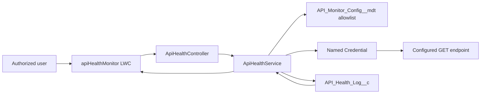

# Architecture

The monitor is intentionally on-demand. It makes a bounded GET callout only after a user chooses **Check Now**. No response body, headers, credentials, or arbitrary URLs are stored or displayed.

`API_Monitor_Config__mdt` is the allowlist: each record supplies an active flag, Named Credential developer name, relative path, and expected status. Apex validates the configuration before forming `callout:<credential><path>`. The browser never supplies a URL.

`ApiHealthController` is thin and enforces the custom permission. `ApiHealthService` executes the callout first and persists a sanitized result second, avoiding DML-before-callout transaction issues. The dashboard reads the newest persisted log for every active configuration.

The **API Health Monitor User** permission set grants the custom permission, controller access, and the minimum log-object permissions. Users also need Named Credential access as required by their org's Named Credential setup.
